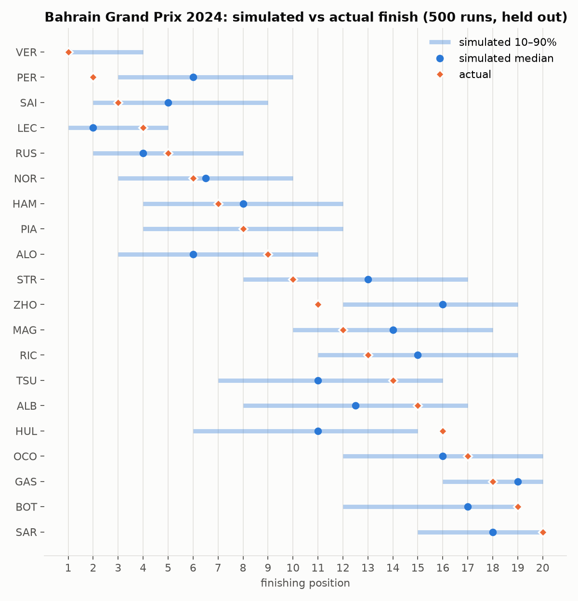
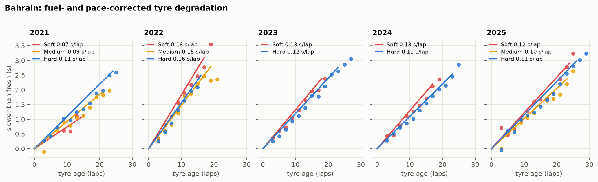

# F1 Neural Race Strategist

An interactive Formula 1 race-strategy simulator and decision-support tool. A
neural lap-time model, trained on real timing data, drives a Monte Carlo race
simulator that evaluates pit strategies and explains why one beats another.

> Status: early development. Phases 0–4 are complete: data pipeline, exploration, an
> evaluation harness with three non-neural baselines, the structured probabilistic
> lap-time network ([validation report](docs/reports/lap_time_models_val.md),
> [model card](docs/MODEL_CARD.md)), the Monte Carlo race simulator
> ([backtest](docs/reports/sim_backtest_val.md)), the strategy optimiser behind a
> FastAPI service ([API](services/api/README.md)), and the Next.js web app
> ([web](apps/web/README.md)): race replay on a circuit map, gap chart, strategy builder and
> optimiser. Next: fix compound labelling (C1–C5 mapping), then deploy. See
> [docs/DESIGN.md](docs/DESIGN.md) for the full design.

**Lap-time forecasting on an unseen season (2024 validation, 19,969 laps):**

| Model | Lap-time MAE | Within-race MAE | NLL |
|---|---|---|---|
| Circuit pace ratio | 1.166 s | 0.852 s | 1.994 |
| Fuel-corrected linear degradation | 0.922 s | 0.533 s | 1.775 |
| LightGBM | 0.927 s | **0.521 s** | 1.850 |
| **Structured network (ensemble of 5)** | **0.864 s** | 0.527 s | **1.607** |

The network is significantly more accurate than LightGBM on absolute lap time (−0.063 s,
95% race-bootstrap interval −0.133 to −0.007), ties it on within-race error, gives the best
calibrated uncertainty, and is best on every metric at Bahrain, the MVP circuit. Its
degradation curves can never decrease with tyre age, so strategy counterfactuals stay
physically plausible.

**Race simulator backtest (2024 Bahrain GP, held out, 500 runs):** replayed from the order
after lap 1 with the strategies actually used, the simulator's median finishing positions
are off by 2.10 places on average (frozen lap-1 order 2.30, grid order 2.30, simulator
without traffic and overtaking 2.35), with rank correlation 0.90 and well-calibrated 80%
intervals (85% coverage).





*Fuel- and pace-corrected tyre degradation at Bahrain, 2021–2025. From
[notebooks/01_bahrain_eda.ipynb](notebooks/01_bahrain_eda.ipynb), which also covers the fuel
effect, the cost of running in traffic, and a data-quality summary.*

## How it works

1. **Learn** — a structured, probabilistic neural network predicts lap times from
   tyre compound and age, fuel load, temperature, traffic and pace. It is benchmarked
   against non-neural baselines on held-out seasons.
2. **Simulate** — a lap-by-lap Monte Carlo race simulator composes the lap-time
   model with pit loss, safety-car and overtaking models to produce counterfactual
   races.
3. **Decide** — an optimiser ranks legal strategies by expected finishing position
   and risk, with a time breakdown explaining each recommendation.

Simulated and estimated values are always labelled as such; only historical data is
presented as fact.

## Repository layout

| Path | Contents |
|---|---|
| `packages/strategist/` | Python core: data pipeline, models, simulator, optimiser, evaluation |
| `services/api/` | FastAPI service (planned) |
| `apps/web/` | Next.js frontend (planned) |
| `configs/` | Experiment and data configs |
| `notebooks/` | Exploration only |
| `docs/` | Design, model card, evaluation reports |

## Getting started

Requires Python 3.11+.

```bash
python -m venv .venv
source .venv/Scripts/activate   # Windows Git Bash; use .venv\Scripts\activate in PowerShell
pip install -e "packages/strategist[dev]"
```

Build the dataset (2021–2025; about 25 minutes on the first run, then served from the
on-disk cache):

```bash
python -m strategist.data.ingest --config configs/data.yaml --wait-on-rate-limit
python -m strategist.data.clean --config configs/data.yaml
```

This writes `data/processed/laps.parquet` (every lap, with features and an
`exclude_reason`) and `data/processed/races.parquet`. See
[docs/DESIGN.md §3](docs/DESIGN.md) for sources, cleaning rules and validation.

Evaluate the lap-time models on the validation season (writes
`docs/reports/lap_time_models_val.md`; about a minute on a CPU):

```bash
python -m strategist.eval.run --config configs/eval.yaml
```

The test season is reserved for the final comparison and needs `--split test --final`.

Backtest the race simulator on Bahrain (trains and caches lap_net and the simulator
parameters under `artifacts/models/` on first run; writes `docs/reports/sim_backtest_val.md`):

```bash
python -m strategist.sim.backtest --config configs/sim.yaml
```

Serve the strategy API (races, simulation, optimisation; docs at `/docs`):

```bash
pip install -e services/api[dev]
python -m strategist.data.tracks --circuit Sakhir   # circuit outline for the replay map
uvicorn app.main:app --app-dir services/api --reload
```

Run the web app (http://localhost:3000):

```bash
npm --prefix apps/web install
npm --prefix apps/web run dev
```

## Disclaimer

Unofficial, non-commercial project. Not associated with Formula 1 companies. F1,
FORMULA ONE and related marks are trademarks of Formula One Licensing B.V. Data via
[FastF1](https://github.com/theOehrly/Fast-F1), [OpenF1](https://openf1.org) and
[Jolpica](https://github.com/jolpica/jolpica-f1).
