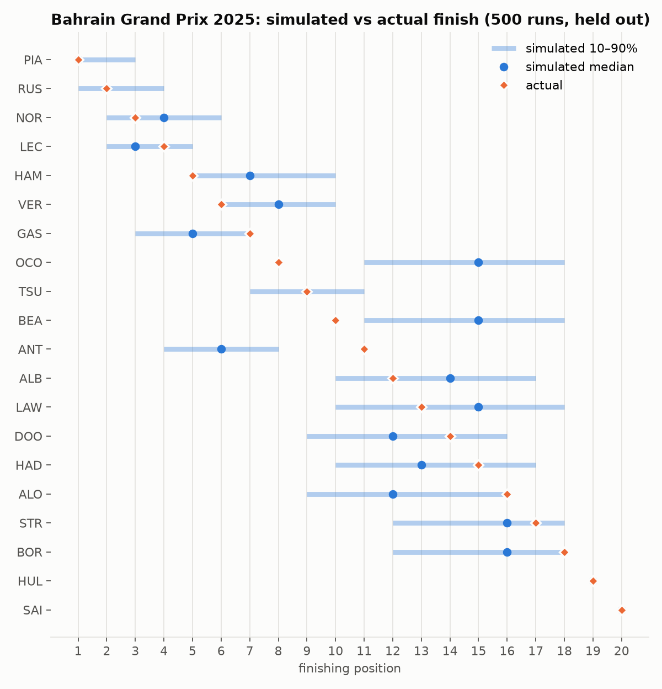

# F1 Neural Race Strategist

An interactive Formula 1 race-strategy simulator and decision-support tool. A
neural lap-time model, trained on real timing data, drives a Monte Carlo race
simulator that evaluates pit strategies and explains why one beats another.

**Live:** https://f1-neural-strategist.vercel.app (try the
[2024 Bahrain GP](https://f1-neural-strategist.vercel.app/race/2024_01)). The API runs on a
small machine that sleeps when idle, so the first request after a quiet spell takes a few
seconds longer.

> Status: phases 0–5 are complete and deployed: data pipeline, exploration, an evaluation
> harness with three non-neural baselines, the structured probabilistic lap-time network
> ([model card](docs/MODEL_CARD.md)), the Monte Carlo race simulator, the strategy optimiser
> behind a FastAPI service ([API](services/api/README.md)), and the Next.js web app
> ([web](apps/web/README.md)). The sealed 2025 test season has been used for the final
> evaluation (results below). Next: the fast strategy surrogate and in-race "pit wall" mode.
> See [docs/DESIGN.md](docs/DESIGN.md) for the full design.

**Final test: lap-time forecasting on the sealed 2025 season** (19,959 laps, 20 dry races;
models refitted on 2021–2024 with the settings fixed during development, scored once;
[report](docs/reports/lap_time_models_test.md)):

| Model | Lap-time MAE | Within-race MAE | NLL | 90% coverage |
|---|---|---|---|---|
| Circuit pace ratio | 1.175 s | 0.832 s | 1.901 | 0.90 |
| Fuel-corrected linear degradation | 1.085 s | 0.512 s | 1.970 | 0.87 |
| LightGBM | 0.986 s | 0.533 s | 1.865 | 0.88 |
| **Structured network (ensemble of 5)** | **0.900 s** | **0.491 s** | **1.625** | 0.86 |

The network is best on every accuracy and likelihood metric. Against LightGBM (95%
race-level paired bootstrap) its within-race error is lower by 0.042 s [0.017, 0.068], the
strategy-relevant gain; the overall MAE gain (−0.086 s [−0.262, +0.075]) and NLL gain are not
distinguishable from race-to-race noise. Where it falls short: its 90% intervals cover only
86% of 2025 laps (every model under-covers), and at the one circuit it had never seen
(Montréal) its absolute error is the worst of the four (1.55 s; the within-race error is
fine), so the "unknown circuit" fallback misplaces the pace level. On the 2024 validation
season the network and LightGBM were tied ([validation report](docs/reports/lap_time_models_val.md)).

Both models know which Pirelli compound (C0–C6) each tyre was: soft/medium/hard mean
different rubber at different races (the Bahrain soft was the C4 in 2021, the C3 since), so
the dataset carries a per-race nomination table ([configs/compounds.csv](configs/compounds.csv),
114 races, compiled from race articles and cross-checked against F1/Pirelli previews). Unlike
the baselines the network is physically constrained: predictions never get faster as tyres
age, and a softer compound is never slower when fresh nor wears less, at any circuit. Those
guarantees are what make its strategy counterfactuals trustworthy.

**Race simulator backtest (Bahrain, held out, 500 runs each):** each race is replayed from
the order after lap 1 with the strategies actually used.

| Held-out race | Simulator position MAE | Frozen lap-1 order | Grid order | Rank correlation | Inside simulated 80% range | P(actual winner) |
|---|---|---|---|---|---|---|
| 2024 (validation) | **2.10** | 2.30 | 2.30 | 0.88 | 90% | 0.52 |
| 2025 (final test) | 2.22 | **1.78** | 2.78 | 0.81 | 83% | 0.74 |

On 2025 the simulator's spread is well calibrated and it gives the actual winner (Piastri)
a 74% chance, but its median positions are worse than simply freezing the lap-1 order: it
underrates the Haas pair (8th and 10th, simulated 15th; race pace better than their
qualifying anchor) and overrates Antonelli. Two held-out races can't separate the simulator
from the lap-1 baseline; positions in midfield remain the weak point
([test backtest](docs/reports/sim_backtest_test.md),
[validation backtest](docs/reports/sim_backtest_val.md)). Asked to re-optimise Verstappen's
2024 race, the optimiser rates his actual soft–hard–soft as within about a second of the
best plan, i.e. near-optimal, as the result suggests.

The live app serves lap_net and simulator parameters refitted on all five seasons
(2021–2025, `python -m strategist.sim.fit`) with the same settings. Every race in the app is
therefore in-sample; the held-out accuracy of this setup is the 2025 test above, where the
same procedure was fitted on 2021–2024.




*Fuel- and pace-corrected tyre degradation at Bahrain, 2021–2025. From
[notebooks/01_bahrain_eda.ipynb](notebooks/01_bahrain_eda.ipynb), which also covers the fuel
effect, the cost of running in traffic, and a data-quality summary.*

## How it works

1. **Learn** — a structured, probabilistic neural network predicts lap times from
   tyre compound and age, fuel load, temperature, traffic and pace. It is benchmarked
   against non-neural baselines on held-out seasons.
2. **Simulate** — a lap-by-lap Monte Carlo race simulator composes the lap-time
   model with pit loss, safety-car and overtaking models to produce counterfactual
   races.
3. **Decide** — an optimiser ranks legal strategies by expected finishing position
   and risk, with a time breakdown explaining each recommendation.

Simulated and estimated values are always labelled as such; only historical data is
presented as fact.

## Repository layout

| Path | Contents |
|---|---|
| `packages/strategist/` | Python core: data pipeline, models, simulator, optimiser, evaluation |
| `services/api/` | FastAPI service |
| `apps/web/` | Next.js frontend |
| `configs/` | Experiment and data configs |
| `notebooks/` | Exploration only |
| `docs/` | Design, model card, evaluation reports |

## Getting started

Requires Python 3.11+.

```bash
python -m venv .venv
source .venv/Scripts/activate   # Windows Git Bash; use .venv\Scripts\activate in PowerShell
pip install -e "packages/strategist[dev]"
```

Build the dataset (2021–2025; about 25 minutes on the first run, then served from the
on-disk cache):

```bash
python -m strategist.data.ingest --config configs/data.yaml --wait-on-rate-limit
python -m strategist.data.clean --config configs/data.yaml
```

This writes `data/processed/laps.parquet` (every lap, with features and an
`exclude_reason`) and `data/processed/races.parquet`. See
[docs/DESIGN.md §3](docs/DESIGN.md) for sources, cleaning rules and validation.

Evaluate the lap-time models on the validation season (writes
`docs/reports/lap_time_models_val.md`; about a minute on a CPU):

```bash
python -m strategist.eval.run --config configs/eval.yaml
```

Backtest the race simulator on Bahrain (trains and caches lap_net and the simulator
parameters under `artifacts/models/` on first run; writes `docs/reports/sim_backtest_val.md`):

```bash
python -m strategist.sim.backtest --config configs/sim.yaml
```

The 2025 test season has been used once for the final evaluation. Both commands accept
`--split test --final`, which refits on 2021–2024 and writes the `_test` reports; it exists
to reproduce those numbers, not to compare new variants.

Serve the strategy API (races, simulation, optimisation; docs at `/docs`):

```bash
pip install -e services/api[dev]
python -m strategist.data.tracks --circuit Sakhir   # circuit outline for the replay map
uvicorn app.main:app --app-dir services/api --reload
```

Run the web app (http://localhost:3000):

```bash
npm --prefix apps/web install
npm --prefix apps/web run dev
```

## Disclaimer

Unofficial, non-commercial project. Not associated with Formula 1 companies. F1,
FORMULA ONE and related marks are trademarks of Formula One Licensing B.V. Data via
[FastF1](https://github.com/theOehrly/Fast-F1), [OpenF1](https://openf1.org) and
[Jolpica](https://github.com/jolpica/jolpica-f1).
