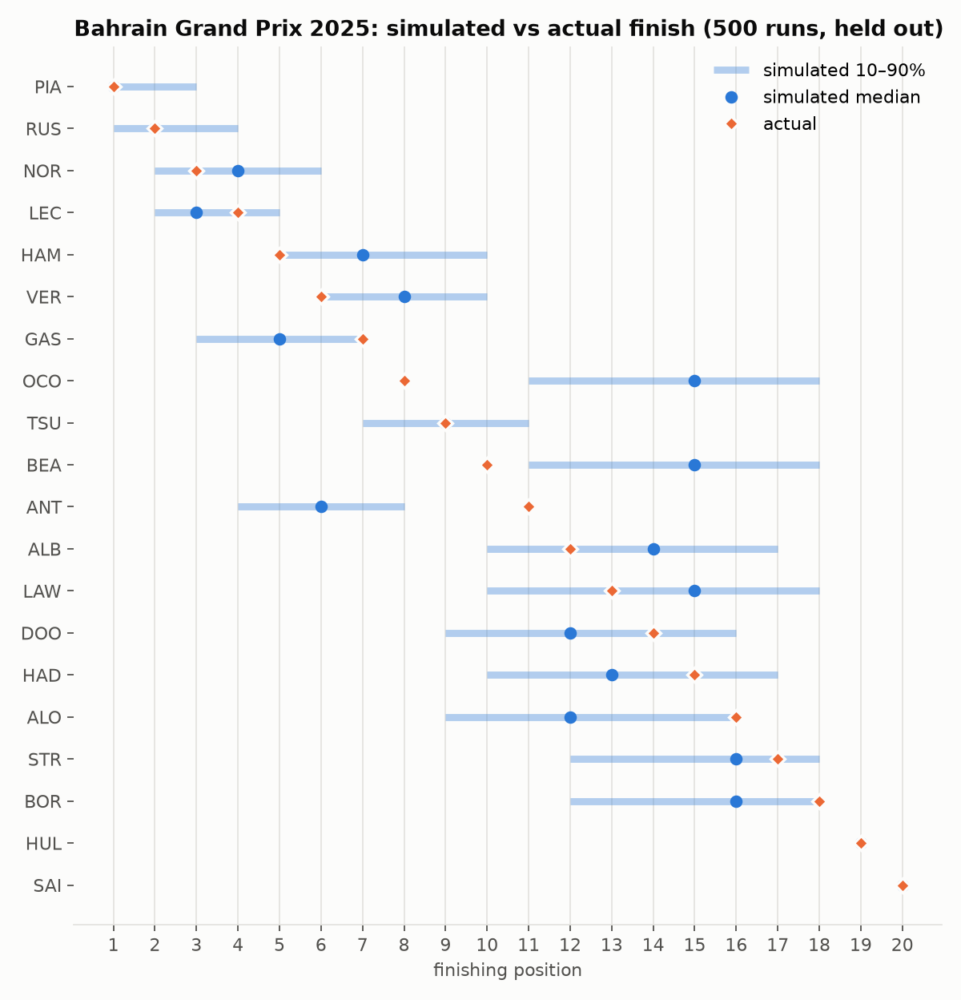

# F1 Neural Race Strategist: case study

A race-strategy simulator built on a neural lap-time model trained on real timing data. It
replays Grands Prix, tests pit strategies that were never raced, and explains why one beats
another. Its results were checked on seasons it never saw, including the experiment that failed.

[Open the live app](https://f1-neural-strategist-tau.vercel.app) ·
[2025 Bahrain GP](https://f1-neural-strategist-tau.vercel.app/race/2025_04)

Last updated 1 November 2026.

## Results at a glance

| Result | Number | What it means |
|---|---|---|
| Held up | 0.900 s MAE | Neural lap-time forecast on the sealed 2025 season, best of four models |
| Held up | 1.42 vs 1.71 places | Simulator against a frozen order, from mid-race across 18 circuits |
| Mixed | 0.906 → 0.665 s | Lap forecasts updated from the laps already run: a real gain, tuned on 2025 |
| Failed | −0.07 places | Those better forecasts did not clearly improve race predictions, so the planned in-race mode was not built |

## The question

Teams choose when to pit and which tyres to fit. Each race only shows one strategy per driver,
so history can't say what would have happened otherwise. Training a network on strategy and
result would mostly learn that front-runners stop once, which is correlation, not cause.

This project learns the building block instead: how long one lap takes given tyres, fuel,
traffic and pace. A lap-by-lap Monte Carlo simulator then composes those laps with pit stops,
overtaking and safety cars. An optimiser enumerates the legal strategies, simulates them with
the same random draws, and ranks them with a time breakdown. Everything simulated is labelled
as simulated in the app.

## Data

The dataset covers 114 races from 2021 to 2025: 124,700 laps, of which 93,500 are clean racing
laps. FastF1 supplies 2021–22, OpenF1 supplies 2023–25, and Jolpica supplies results and
qualifying. Pit laps, lap 1, safety-car laps, wet running and slow outliers are excluded with a
recorded reason, so each exclusion can be audited.

Seasons are split whole, never by random lap. Each lap is modelled relative to the driver's best
qualifying lap, which carries car, driver and circuit pace across seasons. Tyres are modelled by
their Pirelli compound on a hardness scale, from a table of nominations compiled for all 114
races, because "soft" means different rubber at different races.

## The lap-time model

The network is additive: base pace, fuel, tyre offset, tyre wear, traffic, and a small bounded
interaction term. The structure gives guarantees that a generic model lacks, enforced by
construction and unit-tested. Lap times never improve as tyres age, fuel always costs time, and
a softer compound is never slower when fresh nor wears less. Those rules keep counterfactual
long stints physically plausible. Five seeds form an ensemble, and the uncertainty head is
trained on errors from seasons the mean model did not see.

Sealed 2025 test: 19,959 laps, 20 races, scored once after refitting on 2021–24.

| Model | Lap MAE (s) | Within-race MAE (s) | NLL | 90% coverage |
|---|---|---|---|---|
| lap_net (ensemble of 5) | **0.900** | **0.491** | **1.625** | 0.862 |
| LightGBM | 0.986 | 0.533 | 1.865 | 0.879 |
| Linear degradation | 1.085 | 0.512 | 1.970 | 0.870 |
| Circuit pace ratio | 1.175 | 0.832 | 1.901 | **0.896** |

Against LightGBM, the within-race gain of 0.042 s (95% race-bootstrap interval 0.017 to 0.068)
is the one difference clear of race-to-race noise. Within-race error is the one that matters
when comparing two strategies for the same driver. Two weaknesses showed up: the uncertainty
ranges are too narrow on a new season, and at Montréal, the one circuit with no training laps,
lap_net's overall pace level was the worst of the four models (1.55 s).

## The simulator

Pit loss, safety-car pace and bunching, overtaking odds and variance are all calibrated from
training seasons rather than assumed. A replay starts from the real order and gaps, with the
strategies, safety cars and retirements that actually happened. That isolates what the simulator
is responsible for from what nobody can forecast.

*2025 Bahrain GP, held out, 500 simulated races from lap 1. 83% of drivers finished inside the
simulated 80% range and the winner was given a 74% chance, but the median positions were worse
than the order after lap 1 (2.22 vs 1.78 places).*

One race can't settle much, so the backtest was widened to every eligible 2025 race. Replayed
from mid-race, the plain simulator beat both simple orders, with intervals that exclude zero.
From lap 1 it was only about level with the frozen order (1.94 vs 1.99 places).

## Updating from the laps already run

Most of lap_net's error is a pace offset that lasts all race: 65% of the variance is shared by
the field and 12% is a driver's offset that day. So the laps already run should help. Two models
forecast lap_net's error on every remaining lap. One is a structured Gaussian process with
readable terms for race, restart, trend, compound, driver and stint. The other is a GRU that
reads each driver's race so far.

MAE (s), 2025 validation season, 20 races:

| Forecast made after | lap_net, no update | Driver's mean error | GP | GRU |
|---|---|---|---|---|
| 10% of the race | 0.895 | 0.931 | 0.808 | **0.716** |
| 25% | 0.906 | **0.641** | 0.649 | **0.641** |
| 50% | 0.918 | 0.631 | **0.630** | 0.632 |
| 75% | 0.923 | 0.652 | **0.571** | 0.615 |
| All cutoffs | 0.906 | 0.749 | 0.697 | **0.665** |

Both models beat no update by about a quarter, and the race-level intervals exclude zero. They
tie with each other on error, and the GRU's uncertainty is better. Neither predicts the rest of
a stint's wear rate any better than lap_net (about 0.05 s per lap of error for all three), so
the gain comes from pace level, not tyre wear. Three structural changes to the GP were made
after seeing 2025, so these figures flatter it. The 2026 test will give the fair number.

## The experiment that failed

An in-race "pit wall" mode was the planned headline feature: pause at lap N and get strategy
advice from how the race is really going. Before building any screens, the update was fed into
the simulator and given a pass/fail test, fixed before the run. It had to beat both the plain
simulator and a pit-adjusted order on finishing position, with both race-level 95% intervals
below zero.

Position MAE (places), 18 dry 2025 races, 500 simulated races per replay:

| Replayed from | Simulator + GP | Simulator | Frozen order | Pit-adjusted order |
|---|---|---|---|---|
| Lap 1 | – | **1.938** | 1.989 | 2.744 |
| 25% | 1.846 | **1.795** | 2.052 | 2.575 |
| 50% | **1.307** | 1.489 | 1.923 | 1.709 |
| 75% | **0.885** | 0.973 | 1.152 | 0.912 |
| Mean of 25–75% | **1.346** | 1.419 | 1.709 | 1.732 |

**It failed.** The gain over the plain simulator was 0.07 places, with a 95% interval of −0.18
to +0.04. It did beat the pit-adjusted order (−0.39 places), helped at half distance, and cut the
error in gap to the winner from 12.6 to 10.5 s. It also lowered the simulated chance of the
actual winner from 0.77 to 0.64. A likely reason, not yet measured, is that much of the update
corrects the pace of the whole field, which moves times more than order. The test stood and the
feature was not built.

## What went wrong along the way

**Lusail looked 4.7 s too slow.** Validation exposed a network that had learned "hotter is
faster" at one circuit from two races. The cause was a stint limit in 2023. The fix was a rule:
race-level conditions may only enter terms shared across circuits.

**The optimiser kept picking the medium.** Labels hid real compounds: the Bahrain soft was the C4
in 2021 and the C3 since. Hardness constraints and the per-race nomination table fixed it, with
18 spot-checks against F1 and Pirelli previews all in agreement.

**Updating made Baku worse.** The race began behind a safety car, and its first green lap ran
3.6 s slower than forecast. The model read that as the race's true pace. Restarts became their
own term, which helped but did not fully fix it: at Baku the updated lap forecasts are still
worse than no update.

**The hosting changed underneath.** The API moved from Fly.io to Render's free tier when a trial
ended. That forced a smaller profile of 512 MB and 100 simulated races per request, plus a slow
wake from sleep. Profiling then showed about 90% of the simulation time was the lap-time network,
so the network and simulator were ported to Rust and compiled to WebAssembly. The strategy
builder now runs 300 races in the visitor's browser, with no quota or wait for the server. Parity
tests replay Python runs' random draws in Rust and require the same lap times.

## The product

The app is a dark pit-wall interface with a race replay on a 2D circuit map, a gap chart, a
drag-to-edit strategy builder and an optimiser that shows odds, time against the race as run,
and a cost breakdown. The front end is Next.js and TypeScript on Vercel, with the simulator in
Rust compiled to WebAssembly. The API is FastAPI in Docker with rate limits and a provenance label
on every response. The models are PyTorch, with LightGBM as a baseline, and GitHub Actions runs
the Python and Rust test suites on every push.

Bahrain is the calibrated circuit in the app. The live models were refitted on all five seasons,
so every race in the app is in-sample; held-out accuracy comes from the tests above.

## Limits and what comes next

- All replays use the strategies and safety cars that really happened, so they test the race
  model, not a full pre-race forecast.
- Opponents don't react to a changed strategy, and differences of about a second between
  strategies are within the model's uncertainty.
- Tyre wear within a stint remains mostly unpredictable, before or during a race.
- The 2026 season stays sealed until Abu Dhabi on 6 December. It has no race at Sakhir and uses a
  new tyre range, so it will be a hard test of the whole system, including the in-race update.

---

MAE: mean absolute error. NLL: Gaussian negative log-likelihood, lower is better. Intervals are
95% paired bootstraps that resample whole races. Full reports are in
[docs/reports](reports/).

Unofficial, non-commercial project, not associated with Formula 1 companies. F1 and FORMULA ONE
are trademarks of Formula One Licensing B.V. Data via FastF1, OpenF1 and Jolpica.
